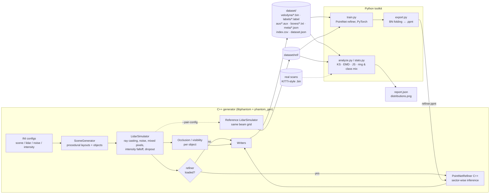

# phantom_points

**Synthetic LiDAR scene generator.** A C++17 pipeline that procedurally builds urban driving
scenes, ray-casts them with a configurable spinning-LiDAR sensor model, and passes each scan
through a PointNet-based *realism refiner* that learns the residual between simulated and
reference sensor output. It produces labeled scans (points, per-point semantic and instance labels,
3D boxes with occlusion levels) at the 10k+ scenario scale for training and validating
perception models. A Python toolkit trains the refiner and runs a statistical distribution
analysis that compares synthetic scans to a reference set.

## What it does

- **Procedural scenes.** Straight roads, 4-way intersections and parking lots with cars,
  trucks, pedestrians, cyclists, poles, trees and buildings. Every object is made of analytic
  primitives (oriented boxes, cylinders, spheres, plane patches), each with its own material
  reflectivity and retro-reflectors (licence plates).
- **Sensor model.** A configurable beam table (uniform, or an explicit non-uniform table such as
  VLP-32C), azimuth resolution, range limits and mounting height.
  - *Noise:* Gaussian range noise that grows with range, beam-pointing jitter, 8-bit intensity
    quantisation, and spurious near-range returns from rain, dust or multipath.
  - *Occlusion:* first-hit ray casting, plus mixed-pixel ghost points where the beam footprint
    (beam divergence, sampled with sub-rays) straddles a depth edge. Each object also gets a
    visibility ratio: rays that hit it in the full scene divided by rays that would hit it if
    it were alone. That ratio sets its KITTI-style occlusion level (0 to 3).
  - *Intensity falloff:* Lambertian plus a retro-reflective lobe, scaled by `(r_ref / r)^k`
    range falloff, two-way atmospheric attenuation `exp(-2αr)`, a near-field clamp and
    receiver saturation. When the received signal is weak, a soft detection threshold
    drops the return.
- **PointNet refiner.** A segmentation-style PointNet without T-Nets. It runs on each azimuth
  sector and predicts a bounded range residual, an intensity residual and a dropout logit for
  every point. Training uses pairs of the *same scene* matched on the (ring, column) grid. The
  weights are exported with BatchNorm folded in, and a dependency-free C++ forward pass applies
  them during generation (no LibTorch needed).
- **Distribution analysis.** KS statistic, Wasserstein distance and Jensen–Shannon / KL
  divergence on range, intensity, height and elevation. It also compares points per ring, points
  per scan and the class mix, and reports occlusion statistics and points-per-object against
  distance.

## Architecture



### Repository layout

| Path | Contents |
|------|----------|
| `include/phantom/`, `src/` | Core library: math, geometry, scene sampler, LiDAR model, noise, config, PointNet inference, I/O, batch generator |
| `apps/phantom_gen.cpp` | Batch generation CLI |
| `configs/` | `default.ini` (64-beam), `vlp32.ini` (32-beam non-uniform), `reference_sensor.ini` (realism target profile) |
| `python/phantom_points/` | Feature layout, model, paired dataset, training, export, readers, statistics |
| `python/analyze.py` | Distribution report CLI |
| `tests/test_core.cpp` | C++ unit tests (CTest) |
| `python/tests/` | pytest suite |
| `scripts/run_pipeline.sh` | End-to-end pipeline |

### Output format

| File | Format |
|------|--------|
| `velodyne/NNNNNN.bin` | float32 `[x, y, z, intensity]` per point, in the sensor frame (KITTI layout) |
| `labels/NNNNNN.label` | uint32 `semantic \| (instance << 16)` (SemanticKITTI layout) |
| `aux/NNNNNN.aux` | uint16 `[ring, column, flags]`. Flags: 1 = mixed pixel, 2 = spurious, 4 = refined |
| `boxes/NNNNNN.txt` | `class x y z length width height yaw occ_level occlusion points speed instance` |
| `meta/NNNNNN.json` | layout, seed, per-class point counts, mixed/spurious counts |
| `index.csv`, `dataset.json` | Scene index and sensor description |

Semantic classes: `0 unlabeled, 1 road, 2 sidewalk, 3 car, 4 truck, 5 pedestrian, 6 cyclist,
7 pole, 8 building, 9 vegetation`.

Scene `i` depends only on `(seed, i)`. That lets you generate a dataset in shards
(`--start`, `--count`) or regenerate any single scene exactly.

## How to run

### Requirements

- CMake ≥ 3.16 and a C++17 compiler (GCC 9+, Clang 10+, MSVC 2019+). No other C++ dependencies.
- Python ≥ 3.9 with `pip install -r python/requirements.txt` (numpy, scipy, torch, matplotlib,
  pytest). You only need Python for training and analysis.
- No GPU is required. Training uses CUDA when it is available. The generator runs on the CPU
  across all cores, at about 15–20 scenes/s for 64×2048 scans on a modern 8-core laptop.
- No credentials or secrets are needed.

### Build

```bash
cmake -S . -B build -DCMAKE_BUILD_TYPE=Release
cmake --build build -j
```

### Generate a dataset

```bash
# 10k labeled scenarios with the physics-based sensor model
./build/phantom_gen --out out/dataset --count 10000 --config configs/default.ini

# a different sensor
./build/phantom_gen --out out/vlp32 --count 1000 --config configs/vlp32.ini

# sharded generation across machines / jobs
./build/phantom_gen --out out/dataset --start 5000 --count 5000 --seed 1
```

### Train and use the PointNet refiner

```bash
# 1. paired data: each scene is rendered by the base model and by the reference sensor profile
./build/phantom_gen --out out/pairs --count 2000 --seed 1000 \
    --config configs/default.ini --pair-config configs/reference_sensor.ini

# 2. train (writes runs/refiner/{best.pt,history.json,refiner.ppnt})
PYTHONPATH=python python -m phantom_points.train --data out/pairs --epochs 20 --out runs/refiner

# 3. generate refined scenarios
./build/phantom_gen --out out/refined --count 10000 --model runs/refiner/refiner.ppnt
```

The reference profile ships as a stand-in. To imitate a real sensor, put scans from that sensor
into `out/pairs/ref/`, re-projected onto the same (ring, column) grid. Alternatively, tune
`reference_sensor.ini` until `analyze.py` shows a small gap against the real logs.

### Statistical analysis

```bash
# describe one dataset
python python/analyze.py --synthetic out/dataset --out reports/dataset --plots

# compare base simulator vs reference sensor (paired ref/ scans)
python python/analyze.py --synthetic out/pairs --reference out/pairs --reference-ref --plots

# compare against real KITTI-format scans (rings estimated from the synthetic beam table)
python python/analyze.py --synthetic out/refined --reference /data/kitti/sequences/00
```

`report.json` holds descriptive statistics and the KS, Wasserstein and JS/KL values for each
feature. Its headline number, `realism_gap`, is the mean JS divergence over the point
features (lower is better).

### Everything at once

```bash
./scripts/run_pipeline.sh                     # 2k pairs, 20 epochs, 10k scenarios
PAIRS=100 SCENES=200 EPOCHS=2 ./scripts/run_pipeline.sh   # quick smoke run
```

## How to test

```bash
# C++ unit tests: ray intersection, config parsing, intensity/detection model,
# scene determinism, occlusion levels, refiner identity/dropout, binary I/O
cmake -S . -B build && cmake --build build -j
ctest --test-dir build --output-on-failure

# Python tests: divergences, ring estimation, dataset pairing targets, feature layout,
# model shapes, and .ppnt export parity (NumPy forward == PyTorch eval forward)
cd python && python -m pytest -q
```

The C++ and Python sides share one feature layout, defined in `python/phantom_points/features.py`
and mirrored in `PointNetRefiner::build_features`. The export parity test checks the NumPy
reference forward pass, which follows the same operation order as the C++ implementation.

## Configuration reference

All keys are optional. See `configs/default.ini` for every key and its default value.

- `[scene]`: road and sidewalk widths, world extent, min/max counts for each object class, and
  layout probabilities.
- `[lidar]`: `beams`, `elevation_min_deg` and `elevation_max_deg` (or an explicit
  `elevations_deg` table), `columns`, `min_range`, `max_range`, `sensor_height`,
  `beam_divergence_mrad`, `edge_samples`.
- `[noise]`: range sigma (base + relative), angular jitter, base and range-dependent dropout,
  soft detection threshold, mixed-pixel probability and edge threshold, intensity noise and
  quantisation, spurious returns per scan.
- `[intensity]`: gain, reference range, falloff exponent, near-field clamp, atmospheric
  attenuation, retro-reflective lobe exponent, saturation.
